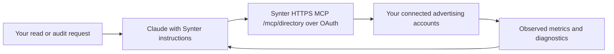

# Synter

Synter helps you review advertising performance, audit tracking and structure, forecast campaigns, and inspect existing plans and audiences through its hosted read-only MCP profile (`/mcp/directory`). Start with the quickstart skill, sign in through the browser OAuth prompt, and verify the connected workspace and advertising account before using account data.

This directory package includes 27 Markdown skills, three agent instructions, and static [brand and safety guidance](context/brand-and-safety.md). Its only service connection is the remote HTTPS MCP server declared in `.mcp.json` (`https://mcp.synterai.com/mcp/directory`). It contains no local lifecycle hooks, executable scripts, or SDK runner. Tool availability follows the bundled [tool directory](tools/directory-tools.json) and the live server schema.

## Install

```text
/plugin install synter --marketplace Synter-Media-AI/plugin
```

All tools in this directory listing are strictly read-only: account lookups, reports, audits, forecasts, and plan inspections run directly. No campaign creation, activation, pause, budget adjustment, or spend-changing tools are exposed by this connector; apply approved changes in the full Synter product at [synterai.com](https://synterai.com) or the ad platform UI. Use the verified advertiser's brand and original assets; do not substitute Synter's branding for another advertiser.



Tool arguments and account results pass through Synter's hosted service and the connected advertising provider. Never paste passwords, API keys, or access tokens into chat. Sample data must be identified as sample data; missing account access or unavailable metrics must be reported plainly. Read [Synter's privacy policy](https://synterai.com/privacy) for data handling and [terms](https://synterai.com/terms) for service conditions.

For help, use the help skill or [contact Synter](https://synterai.com/contact). This folder is generated from reviewed repository sources and is intended for the Claude directory submission path `packages/claude-directory`. Directory approval and publication are separate from local package validation. The source is distributed under the included MIT license.
