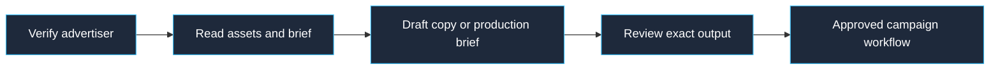

# Prepare ad creative

Confirm the selected workspace with `list_connected_accounts`. Resolve the advertiser's name, domain, offer, audience, and approved claims. Read [brand and safety guidance](../../context/brand-and-safety.md), then use `list_creative_assets` for available original assets. Ask for any missing logo, voice, or destination.

For text ads, use `create_ad_copy` with the verified platform, audience, offer, and brand context. Give each variant a distinct testable idea, and preserve platform limits. For images, video, or audio, prepare a brief with the asset references, composition or shot list, script, format, and exact CTA. The directory connection does not expose image, video, audio generation, or asset upload; identify the production step still needed rather than claiming a generated file exists.

Review the exact copy and available assets for brand match, substantiated claims, and placement requirements. Drafting does not authorize publication. Use the **launch** workflow only within an explicitly approved campaign scope and verify the effective campaign state after execution.

