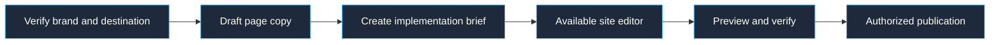

# Prepare a landing page

Confirm the workspace and advertiser using `list_connected_accounts` and the user's verified context. Read [brand and safety guidance](../../context/brand-and-safety.md). Use `list_creative_assets` to identify approved original assets. Establish the audience, offer, evidence, and intended conversion before drafting.

Use the user's real form, calendar, or checkout destination. Never invent a destination or assume the advertiser uses Synter's own website. For Synter itself, use the verified canonical domain https://synterai.com. Identify the existing analytics and attribution requirements without claiming that a proposed form or tracking event is already installed.

Draft the hero, offer explanation, supporting evidence, objection handling, and primary CTA as connected page copy. Include a mobile and desktop implementation brief with typography, exact asset references, section order, form destination, and accessibility requirements. Label missing proof or assets clearly.

This directory connection has no website creation or publishing tool. If the host has a separately available, user-authorized site editor, inspect its capabilities and use that editor's preview and publishing workflow. Otherwise deliver the copy and implementation brief and state that no page has been published. Verify the actual rendered page, links, form submission, and tracking before reporting a page live.

