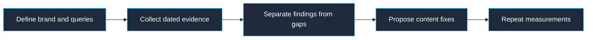

# Audit AI search visibility

Identify the verified brand, canonical domain, target customers, and buying questions. This directory connection has no AI-search visibility measurement tool. Use evidence the user supplies, or a separately available research tool when authorized. Record the exact query, engine, date, source URL, and observed citation for each measured result. Never invent a visibility score or treat a page change as proof of ranking.

Review the website's clarity about the company, product, pricing, and supported claims. Where actual page or crawl evidence is available, check robots directives, accessible documentation, and structured data for accuracy. A crawler allowance or an index file does not establish that an AI service will ingest or cite the site. Respect the owner's crawl preferences; do not recommend removing restrictions without understanding their purpose.

Separate the report into observations supported by evidence, missing measurements, and proposed fixes. Prioritize incorrect entity details, inaccessible relevant content, and unsupported claims. Make factual recommendations specific to the page or query and link the evidence. Re-run the same dated queries after changes before describing an improvement.

